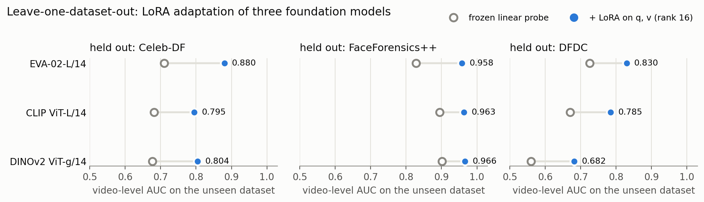
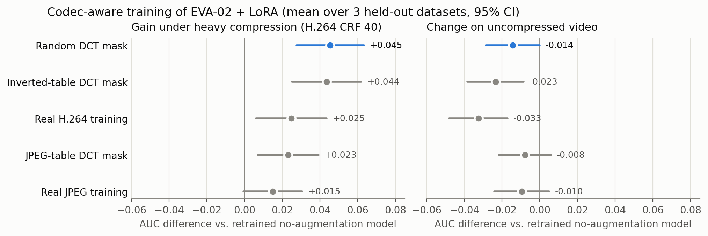

# Deepfake detection under real-world compression

[](requirements.txt)
[](https://pytorch.org)
[](LICENSE)

Deepfake detectors that look excellent on their own benchmark often fail on footage from an unseen source, and fail again once that footage has been compressed for sharing. This repository studies both problems on three public face-forgery datasets (Celeb-DF, FaceForensics++ and DFDC):

1. **Generalisation:** we adapt large vision foundation models with LoRA and evaluate them leave-one-dataset-out (train on two datasets, test on the unseen third).
2. **Compression robustness:** we run controlled experiments on codec-aware training, asking whether a detector benefits from a frequency-domain prior shaped like a real codec (the JPEG quantisation table) or from generic frequency dropout.

Everything is evaluated with paired, cluster-level bootstrap intervals, training-noise controls and decision rules fixed before the results were seen.

*Senior design project (CSE 499A/B), North South University, 2026. Advisor: Dr. Riasat Khan. A manuscript is in preparation.*

---

## Highlights

- **Foundation models generalise much better than CNNs.** EVA-02-L/14 with LoRA on the attention projections reaches a mean held-out AUC of **0.889**. That beats our best CNN (an RGB + frequency dual-stream EfficientNet) on the same frames by **+0.072, +0.086 and +0.090** on Celeb-DF, FF++ and DFDC; all three intervals exclude zero.
- **Small adaptation budget.** LoRA trains under 0.6% of the parameters. Keeping DINOv2-g's frozen weights in fp16 let the 1.1B-parameter model train on free 16 GB T4 GPUs.
- **Compression still breaks the best model.** Re-encoding the test video with H.264 at CRF 40 costs EVA-02 + LoRA **0.071 to 0.197 AUC**, depending on the held-out dataset.
- **The codec-shaped prior is not what helps.** At a matched drop rate, a *random* 8×8 DCT-coefficient mask improves AUC at CRF 40 by **+0.045** [0.028, 0.063]. The JPEG-table mask gives +0.023, and training on real H.264 video only +0.025, at a larger clean-video cost. The CNN experiments point the same way.
- **Careful about our own claims.** A follow-up that matches mask *strength* (removed energy) is pre-registered and in progress. While running it we found and fixed a silent data-reproducibility issue (see [Reproducibility notes](#reproducibility-notes)).

<p align="center"></p>
<p align="center"></p>

---

## Results

### 1. Foundation models with LoRA (leave-one-dataset-out)

Video-level AUC on the held-out dataset, frozen linear probe → LoRA (q, v projections, rank 16, α = 32, seed 42).

| Backbone | Celeb-DF | FaceForensics++ | DFDC | Mean (LoRA) |
|---|---|---|---|---|
| CLIP ViT-L/14 | 0.682 → 0.795 | 0.895 → 0.963 | 0.670 → 0.785 | 0.848 |
| DINOv2 ViT-g/14 | 0.677 → 0.804 | 0.902 → 0.966 | 0.560 → 0.682 | 0.817 |
| **EVA-02-L/14** | 0.710 → **0.880** | 0.828 → **0.958** | 0.725 → **0.830** | **0.889** |

All nine LoRA − probe differences have 95% intervals above zero. Follow-ups ([`results/phase13b_followups`](results/phase13b_followups)):
- LoRA on q, k, v, o at rank 8 ties q, v at rank 16 (mean held-out 0.8895 vs 0.8892).
- Three training seeds on the DFDC fold give 0.830, 0.818 and 0.828 (SD 0.006).

### 2. Compression hurts every model

AUC drop from resize-only to H.264 CRF 40 on the same videos (Gate 0, [`results/gate0_compression_shift`](results/gate0_compression_shift)). A shortcut audit of file processing history found no exploitable cue (AUC ≤ 0.53).

| Model | Celeb-DF | FaceForensics++ | DFDC |
|---|---|---|---|
| EfficientNet-B0 (RGB) | −0.114 | −0.070 | −0.123 |
| Dual-stream EfficientNet (RGB + DCT) | −0.170 | −0.075 | −0.104 |
| EVA-02-L/14 + LoRA | −0.197 | −0.090 | −0.071 |

EVA-02 stays well above the CNNs after compression, but it loses about as much as they do.

### 3. Codec-aware training (EVA-02 + LoRA)

Every arm retrains the same recipe and differs only in its training-time augmentation. Deltas are against a retrained no-augmentation arm, as means over the three held-out datasets with 95% intervals widened for training noise ([`results/d1_strength_analysis`](results/d1_strength_analysis)).

| Training augmentation | CRF 40 | JPEG q20 | CRF 23 | Clean |
|---|---|---|---|---|
| Random 8×8 DCT mask (p = 1) | **+0.045** | **+0.018** | −0.004 | −0.014 |
| Inverted-table DCT mask | +0.044 | +0.007 | −0.014 | −0.023 |
| Real H.264 clips (CRF 23–40, p = 0.5) | +0.025 | −0.014 | −0.029 | −0.033 |
| JPEG-table DCT mask | +0.023 | +0.010 | −0.004 | −0.008 |
| Real JPEG (q 20–95, p = 0.5) | +0.015 | +0.004 | −0.009 | −0.010 |

- **Masking beats the JPEG table.** At the same mean drop rate (0.169), the JPEG-table mask is **0.022 worse** than the random mask at CRF 40 ([−0.038, −0.007]).
- **The gains are specific to heavy compression.** No arm helps at CRF 23, and every arm costs some clean-video accuracy.
- **The CNNs agree** ([`results/phase14b_codec_mask_cnn`](results/phase14b_codec_mask_cnn)). The table mask beats plain fine-tuning by only +0.005 at JPEG q20, random masking at the same rate does as well or better, and real JPEG training gives the largest JPEG gain (+0.026).

### 4. Strength-matched follow-up (in progress)

At the same drop probability, the JPEG-table mask removes 4–8× less image energy than the random mask, because it drops mostly high-frequency coefficients. So "worse ordering" and "weaker augmentation" are confounded.

**What we did:**
- Rescaled each ordering to the same expected removed energy, calibrated per fold on that fold's training crops and checked after the 224 px resize.
- Fixed the analysis before running (a 2 × 2 of ordering × strength, with a decision rule).

**What we found so far** ([`notebooks/07_strength_matched_masks.ipynb`](notebooks/07_strength_matched_masks.ipynb)):
- The pre-registered ordering effect at CRF 40 is −0.008 [−0.019, +0.002], which the rule calls **inconclusive**.
- That cross-session comparison is confounded by a change in the training sample (next section).
- On a single data sample, the JPEG-table and inverted orderings at equal strength differ by −0.010 [−0.024, +0.005].

The reference arms are being retrained on the same pinned data ([`notebooks/08_pinned_data_reference_arms.ipynb`](notebooks/08_pinned_data_reference_arms.ipynb)).

### 5. CNN baseline study (CSE 499A)

An EfficientNet-B0 detector with identity-grouped splits, within-dataset, cross-dataset and leave-one-out evaluation, Grad-CAM analysis and a corruption study.
- **Within a dataset** it reaches AUC 0.994. **On an unseen dataset** it drops to 0.765–0.856, and its attention drifts off the face.
- One round of aggressive recompression reduces the transferred signal to chance.
- An ensemble of independent detectors gave the largest single improvement.

Report source and slides: [`report/`](report). Results: [`results/499a_cnn`](results/499a_cnn).

---

## Method in brief

| | |
|---|---|
| **Data** | Celeb-DF, FaceForensics++ and DFDC face crops (Kaggle mirrors, see below). Splits are grouped by video, and by source identity for FF++, so no identity crosses train/val/test. |
| **Protocol** | Leave-one-dataset-out over the three datasets. Training uses 9,000 frames per source dataset, spread across videos (one frame per video before any video gets a second). Testing scores 8 frames per video, and a video's score is the mean frame probability. |
| **Models** | `timm` EVA-02-L/14, CLIP ViT-L/14 and DINOv2 ViT-g/14. LoRA on q and v (rank 16, α = 32, dropout 0.05). The head is initialised from the frozen linear probe (LP-FT). 4 epochs, AdamW at 2e-4, AMP, DataParallel on 2 × T4. |
| **DCT masks** | One 8×8 keep-mask per image, shared by every block and channel; DC is never dropped. Drop probabilities follow the JPEG luminance table, a uniform table or the inverted table, all at the same mean (0.169). The mask is applied to the crop at native resolution, before the 224 px resize. |
| **Test conditions** | Clean, resize to 224, JPEG q50/q20, and H.264 CRF 23/40 (libx264 re-encoding of each video's sampled face crops as one clip). |
| **Statistics** | Paired cluster bootstrap (1,000 resamples; clusters are videos or FF++ identity groups) on identical videos. Intervals are widened by run-to-run training noise. Decision rules are fixed in advance. |

The shared code lives in [`src/`](src):
- `foundation_lora.py`: data, folds, LoRA, probes, training and scoring
- `codec7.py`: codec round trips, DCT masks, the paired bootstrap and the CNN experiments
- `d1lib.py`: training-time codec augmentations and strength-matched tables

Each notebook carries its own copy of the code it needs, so it runs as a single Kaggle notebook.

## Repository layout

```
deepfake-codec-robustness/
├── notebooks/         Kaggle notebooks, in the order the experiments were run
├── src/               shared library code (the notebooks embed the same files)
├── analysis/          local analysis and figure scripts (CPU only)
├── results/           every result file: AUC tables, per-video predictions, logs, plots
├── data/              item-5 face-set manifest (images are not redistributed)
├── report/            CSE 499A report (LaTeX) and slides
└── assets/            README figures
```

| Notebook | Experiment | Results |
|---|---|---|
| `01_foundation_lora` | CLIP, DINOv2 and EVA-02 + LoRA, leave-one-dataset-out | `results/phase13_foundation_lora` |
| `02_foundation_lora_followups` | q,k,v,o variant, seeds, CNN re-scoring on the same frames | `results/phase13b_followups` |
| `03_codec_mask_cnn_pilot` | JPEG-table masking pilot on the dual-stream CNN | `results/phase14_codec_mask_pilot` |
| `04_codec_mask_cnn_full` | 3 folds × 8 arms, CNN | `results/phase14b_codec_mask_cnn` |
| `05_compression_shift_gate0` | Compression shift and shortcut audit | `results/gate0_compression_shift` |
| `06_codec_aware_lora` | Codec-aware training of EVA-02 + LoRA (sessions 1–2) | `results/d1_session1`, `results/d1_session2` |
| `07_strength_matched_masks` | Strength-matched masks (session 3) | `results/d1_session3_strength` |
| `08_pinned_data_reference_arms` | Reference arms on the pinned data (session 4) | in progress |
| `09_new_generator_faces` | Real/SD3/FLUX face set for unseen generators | `data/item5_faces_manifest.csv` |
| `10_new_generator_scoring` | Scoring of unseen generators with a colour-statistics control | in progress |

## Reproducing

**GPU experiments (Kaggle, 2 × T4, Internet on).** Import a notebook (File → Import Notebook) and attach the public face-crop datasets:
- `amanrawat001/celeb-df-preprocessed`
- `debajyatidey/faceforensics-videos-cropped-faces`
- `itamargr/dfdc-faces-of-the-train-sample`

Then:
1. Run once with `SMOKE = True` (about an hour, every code path on tiny data).
2. Set `SMOKE = False` and commit.

Each notebook's first cell lists any extra inputs (for example, the Phase 13 checkpoints for the codec experiments). Base weights download from Hugging Face through `timm`.

**Analysis (local, CPU).**

```bash
pip install -r requirements.txt
python analysis/d1_merge.py              # sessions 1 + 2: AUCs, paired deltas, replicate, gap closure
python analysis/d1_strength_analysis.py  # pre-registered 2 x 2 for the strength-matched run
python analysis/make_figures.py          # README figures
```

Both analysis scripts reproduce the committed CSVs byte for byte.

**Not included.** Model weights and cached features are too large for the repository; they are available on request. Dataset images are not redistributed: the face datasets have their own licences, and the item-5 set contains real FFHQ faces.

## Reproducibility notes

**The data-order issue.** The face-crop lists were originally built by walking the dataset folders in whatever order the filesystem returned. When Kaggle's storage changed this listing order, two things moved:
- the FF++ identity-group names, which moved 46% of FF++ videos to a different split
- the seeded training-frame sample

The held-out test frames did not change (they are sorted by path), so the evaluation-only consistency check still passed and the change was easy to miss.

**The fix.**
1. The folder walk is now sorted.
2. Each run checks the SHA-256 of the full frame bank against the expected sample, and the calibration scales as an order check, before any training starts.
3. Every trained unit records the data fingerprint in its signature, so a unit trained on different data is never reused.

The two frame banks are kept in `results/d1_session1/probe/` and `results/d1_session3_strength/probe/` (gzipped). Sessions 1 and 2 used identical data, so their comparisons stand.

## Related work

The operator and the idea of frequency masking are not new. What this project contributes is the controlled comparison: codec-shaped vs. random vs. inverted masks, against real-codec training, on a foundation-model detector under leave-one-dataset-out.
- **HiDDeN** (Zhu et al., ECCV 2018). Its JPEG-Drop is the same block-DCT dropout scaled by the JPEG table, used for watermarking.
- **Frequency masking for universal deepfake detection** (Doloriel and Cheung, ICASSP 2024). Random frequency masking; all-band masking works best.
- **FMSI** (Electronics 2025) and **ACMF** (2023). Masked frequency representations for face-forgery detection.
- **F3-Net** (Qian et al., ECCV 2020) and **CAT-Net** (Kwon et al., IJCV 2022). Frequency-aware forgery detection and JPEG-artifact features.
- **DDA** (NeurIPS 2025). DINOv2 + LoRA, motivated by JPEG's removal of high frequencies.

## Roadmap

- [x] Foundation models + LoRA under leave-one-dataset-out
- [x] Compression shift of CNNs and foundation models
- [x] Codec-aware training: JPEG-table vs. random vs. inverted masks vs. real codecs
- [ ] Strength-matched comparison on pinned data, plus additional training seeds
- [ ] Mechanism analysis: test-time DCT band removal and attention drift under compression
- [ ] Unseen codecs (HEVC, AV1, platform-style re-encoding) and unseen generators (SD3, FLUX.1)
- [ ] Reliability per compression level: threshold transfer and abstention

## Authors

**Kawser Sikder** and **Tasneem Abdullah Aurnobb**, Department of Electrical and Computer Engineering, North South University. Supervised by **Dr. Riasat Khan**.

## Citation

```bibtex
@misc{sikder2026deepfakecodec,
  title  = {Deepfake Detection under Real-World Compression: Foundation Models, LoRA and Codec-Aware Training},
  author = {Sikder, Kawser and Aurnobb, Tasneem Abdullah},
  year   = {2026},
  howpublished = {\url{https://github.com/kawsersikder/deepfake-codec-robustness}},
  note   = {Senior design project, North South University}
}
```

## License

Code is released under the [MIT License](LICENSE). The face datasets remain under their original licences.
